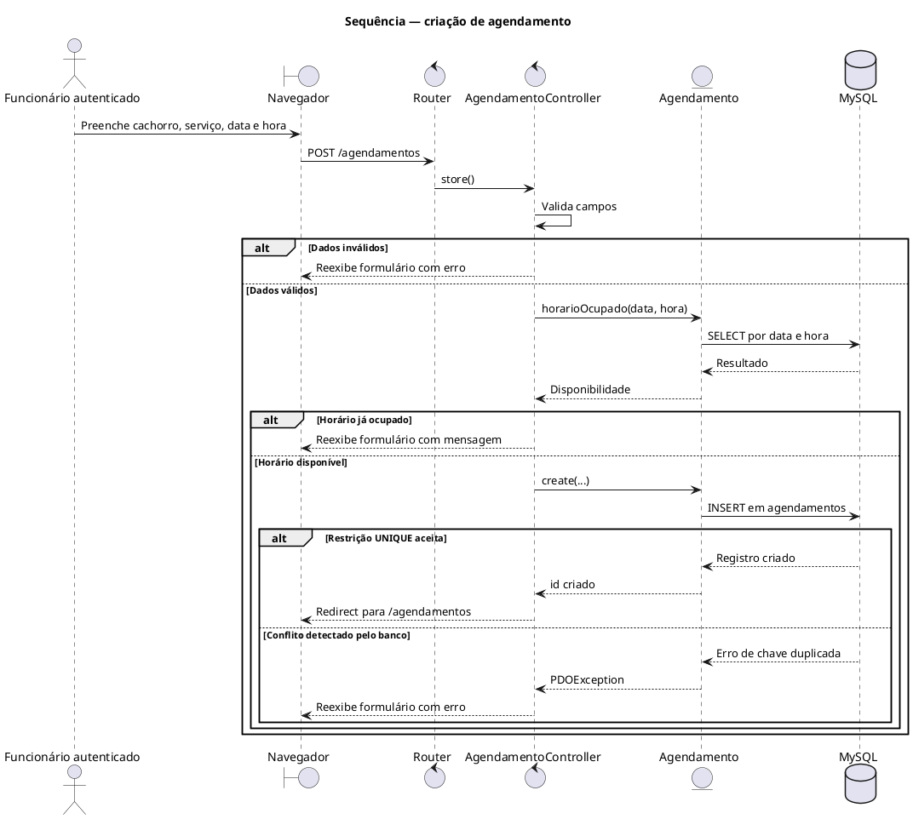

Atualize a Tabela 2 para esta lista, mantendo UC01–UC14 e acrescentando UC15–UC18:

| Código | Caso de uso | Descrição |
|---|---|---|
| UC01 | Consultar agenda | Exibe os agendamentos da data selecionada, ordenados por horário. Por padrão, a página inicial exibe a data atual e permite navegar para outras datas. |
| UC02 | Listar proprietários | Exibe os proprietários cadastrados e informações resumidas de visitas e gastos. |
| UC03 | Cadastrar proprietário | Cadastra um proprietário com nome e celular obrigatórios e observações opcionais. |
| UC04 | Editar proprietário | Altera os dados de um proprietário existente. |
| UC05 | Excluir proprietário | Exclui o proprietário; os cachorros vinculados e os agendamentos deles são removidos em cascata. |
| UC06 | Listar cachorros | Exibe os cachorros cadastrados e seus proprietários, com busca por nome do cachorro ou do proprietário. |
| UC07 | Cadastrar cachorro | Cadastra um cachorro vinculado a um proprietário; nome, proprietário e porte são obrigatórios no formulário. |
| UC08 | Editar cachorro | Altera os dados de um cachorro existente. |
| UC09 | Excluir cachorro | Exclui o cachorro e, em cascata, os agendamentos associados. |
| UC10 | Listar agendamentos | Exibe os agendamentos cadastrados, ordenados por data e horário, com cachorro, proprietário, serviço e status. |
| UC11 | Criar agendamento | Cria agendamento para um cachorro e serviço existentes, com data, hora e observações opcionais. O status inicial é `agendado`. |
| UC12 | Editar agendamento | Altera cachorro, serviço, data, hora, observações e/ou status de um agendamento existente. |
| UC13 | Alterar status do agendamento | Altera o status pela edição do agendamento ou pelas ações rápidas disponíveis na agenda/listagem. A aplicação aceita `agendado`, `andamento`, `concluido` e `cancelado`. |
| UC14 | Excluir agendamento | Exclui um agendamento. O horário fica disponível novamente; seu histórico associado também é excluído. |
| UC15 | Gerenciar serviços | Lista, cadastra e edita serviços e seus preços; permite excluir serviços sem uso ou inativar serviços já associados a agendamentos. |
| UC16 | Consultar histórico de status | Exibe as alterações de status registradas, com dados do agendamento, cachorro, proprietário e serviço. |
| UC17 | Autenticar-se | Permite ao funcionário entrar com login e senha válidos. Não há cadastro de usuário pela interface; a conta é criada ou redefinida por script de linha de comando. |
| UC18 | Encerrar sessão | Encerra a sessão autenticada do funcionário e retorna à tela de login. |

**Ator:** use “Funcionário” como ator. UC17 ocorre antes da autenticação; UC01–UC16 e UC18 exigem sessão autenticada. Inclua essa observação na legenda do diagrama, em vez de chamar o ator de “Funcionário autenticado” no caso de uso de login.

**Relações:** UC13 é um caso de uso próprio, sem relação obrigatória `«include»` com UC12, pois também pode ser iniciado pelas ações rápidas da agenda/listagem. Não desenhe relações `«include»` ou `«extend»` sem correspondência explícita no comportamento implementado.

**Fluxos detalhados:** atualize a descrição dos casos de uso já existente no documento:

- UC01 deve dizer “data selecionada”; o dashboard usa hoje por padrão, mas também permite consultar outra data.
- UC07 deve tratar porte como obrigatório no formulário. Embora a coluna do banco aceite `NULL`, o controller rejeita porte vazio.
- UC11/UC12: em erro, o controller reapresenta os dados recebidos do formulário de agendamento. A validação de campos ausentes e a validação de formato de data/hora têm mensagens diferentes; descreva as mensagens realmente exibidas.
- UC03/UC04: não diga que os dados digitados são preservados após erro de nome/celular obrigatório. O controller reabre o formulário, mas não repassa esses valores para renderização nesses fluxos.
- UC13: descreva as ações rápidas e a edição, os quatro status válidos e o registro das alterações no histórico.
- UC15: serviço associado a agendamentos é inativado, em vez de excluído; serviço sem uso pode ser excluído.
- UC16: o histórico guarda alterações de status, não um registro de criação de cada agendamento.
- UC17/UC18: não existe tela de cadastro de usuário; o logout exige sessão e encerra a sessão atual.

## 4. Dicionário de dados — seção 3.5

Substitua o dicionário por tabelas que correspondam ao `docker/php/db/init.sql`. Tipos de chave primária e estrangeira são `INT UNSIGNED`; as datas de auditoria são `TIMESTAMP`, não `DATETIME`.

### `proprietarios`

| Campo | Tipo | Nulo | Chave / restrição | Descrição |
|---|---|---|---|---|
| id | INT UNSIGNED | Não | PK, AUTO_INCREMENT | Identificador do proprietário |
| nome | VARCHAR(120) | Não | — | Nome |
| celular | VARCHAR(20) | Não | — | Telefone de contato |
| observacoes | TEXT | Sim | — | Observações |
| criado_em | TIMESTAMP | Não | DEFAULT CURRENT_TIMESTAMP | Data/hora de criação |
| atualizado_em | TIMESTAMP | Não | DEFAULT CURRENT_TIMESTAMP, ON UPDATE CURRENT_TIMESTAMP | Data/hora da última atualização |

### `cachorros`

| Campo | Tipo | Nulo | Chave / restrição | Descrição |
|---|---|---|---|---|
| id | INT UNSIGNED | Não | PK, AUTO_INCREMENT | Identificador do cachorro |
| proprietario_id | INT UNSIGNED | Não | FK → `proprietarios.id`, ON DELETE CASCADE | Proprietário |
| nome | VARCHAR(80) | Não | — | Nome |
| raca | VARCHAR(80) | Sim | — | Raça |
| porte | ENUM('pequeno','medio','grande') | Sim | — | Porte armazenado sem acento |
| pelagem | VARCHAR(80) | Sim | — | Pelagem |
| observacoes | TEXT | Sim | — | Observações |
| criado_em | TIMESTAMP | Não | DEFAULT CURRENT_TIMESTAMP | Data/hora de criação |
| atualizado_em | TIMESTAMP | Não | DEFAULT CURRENT_TIMESTAMP, ON UPDATE CURRENT_TIMESTAMP | Data/hora da última atualização |

### `servicos`

| Campo | Tipo | Nulo | Chave / restrição | Descrição |
|---|---|---|---|---|
| id | INT UNSIGNED | Não | PK, AUTO_INCREMENT | Identificador do serviço |
| nome | VARCHAR(80) | Não | — | Nome configurável do serviço |
| descricao | VARCHAR(255) | Sim | — | Descrição |
| preco | DECIMAL(10,2) | Não | DEFAULT 0.00 | Preço |
| ativo | TINYINT(1) | Não | DEFAULT 1 | Indica se o serviço está disponível para novos agendamentos |
| criado_em | TIMESTAMP | Não | DEFAULT CURRENT_TIMESTAMP | Data/hora de criação |
| atualizado_em | TIMESTAMP | Não | DEFAULT CURRENT_TIMESTAMP, ON UPDATE CURRENT_TIMESTAMP | Data/hora da última atualização |

### `agendamentos`

| Campo | Tipo | Nulo | Chave / restrição | Descrição |
|---|---|---|---|---|
| id | INT UNSIGNED | Não | PK, AUTO_INCREMENT | Identificador do agendamento |
| cachorro_id | INT UNSIGNED | Não | FK → `cachorros.id`, ON DELETE CASCADE | Cachorro atendido |
| servico_id | INT UNSIGNED | Não | FK → `servicos.id`, ON DELETE RESTRICT | Serviço associado |
| data | DATE | Não | Parte da restrição UNIQUE (`data`, `hora`) | Data do atendimento |
| hora | TIME | Não | Parte da restrição UNIQUE (`data`, `hora`) | Horário do atendimento |
| status | ENUM('agendado','andamento','concluido','cancelado') | Não | DEFAULT 'agendado' | Situação; valores armazenados sem acento |
| observacoes | TEXT | Sim | — | Observações |
| criado_em | TIMESTAMP | Não | DEFAULT CURRENT_TIMESTAMP | Data/hora de criação |
| atualizado_em | TIMESTAMP | Não | DEFAULT CURRENT_TIMESTAMP, ON UPDATE CURRENT_TIMESTAMP | Data/hora da última atualização |

### `historico_agendamentos`

| Campo | Tipo | Nulo | Chave / restrição | Descrição |
|---|---|---|---|---|
| id | INT UNSIGNED | Não | PK, AUTO_INCREMENT | Identificador do evento |
| agendamento_id | INT UNSIGNED | Não | FK → `agendamentos.id`, ON DELETE CASCADE | Agendamento relacionado |
| status_anterior | ENUM('agendado','andamento','concluido','cancelado') | Não | — | Status anterior |
| status_novo | ENUM('agendado','andamento','concluido','cancelado') | Não | — | Novo status |
| alterado_em | TIMESTAMP | Não | DEFAULT CURRENT_TIMESTAMP | Data/hora da alteração |

O trigger `trg_historico_status_agendamento` insere registros quando o status muda. A view `vw_historico_agendamentos` reúne esses registros com os dados do agendamento, cachorro, proprietário e serviço.

### `usuarios`

| Campo | Tipo | Nulo | Chave / restrição | Descrição |
|---|---|---|---|---|
| id | INT UNSIGNED | Não | PK, AUTO_INCREMENT | Identificador do usuário |
| nome | VARCHAR(120) | Não | — | Nome |
| login | VARCHAR(60) | Não | UNIQUE | Login |
| senha_hash | VARCHAR(255) | Não | — | Hash da senha |
| criado_em | TIMESTAMP | Não | DEFAULT CURRENT_TIMESTAMP | Data/hora de criação |

### `login_tentativas`

| Campo | Tipo | Nulo | Chave / restrição | Descrição |
|---|---|---|---|---|
| id | INT UNSIGNED | Não | PK, AUTO_INCREMENT | Identificador da tentativa |
| login | VARCHAR(60) | Não | Índice composto (`login`, `ip`, `criado_em`) | Login tentado |
| ip | VARCHAR(45) | Não | Índice composto (`login`, `ip`, `criado_em`) | Endereço IP |
| criado_em | TIMESTAMP | Não | DEFAULT CURRENT_TIMESTAMP; índice composto | Data/hora da tentativa |

Também existem índices auxiliares de busca definidos no `init.sql` e em migrations. Liste-os somente se o padrão do dicionário exigir documentação de índices.

## 5. Relacionamento entre casos de uso e tabelas

Corrija a tabela de rastreabilidade para incluir os serviços e tabelas de suporte:

| Caso de uso / operação | Tabelas principais |
|---|---|
| UC01, UC10 — Consultar agenda e listar agendamentos | `agendamentos`, `cachorros`, `proprietarios`, `servicos` |
| UC02–UC05 — Gerenciar proprietários | `proprietarios`; consultas também agregam cachorros, agendamentos e serviços |
| UC06–UC09 — Gerenciar cachorros | `cachorros`, `proprietarios` |
| UC11–UC14 — Criar, editar, alterar status e excluir agendamentos | `agendamentos`, `cachorros`, `servicos`; UC13 também grava em `historico_agendamentos` pelo trigger |
| UC15 — Gerenciar serviços | `servicos`; `agendamentos` é consultada para verificar se o serviço está em uso |
| UC16 — Consultar histórico de status | `historico_agendamentos`; a tela consulta `vw_historico_agendamentos`, que relaciona também `agendamentos`, `cachorros`, `proprietarios` e `servicos` |
| UC17 — Autenticar-se | `usuarios`, `login_tentativas` |
| UC18 — Encerrar sessão | Sessão da aplicação; não altera tabelas do banco |

## 6. Diagramas

Os fontes PlantUML em `docks/diagramas/` e as imagens exportadas/inseridas no Word devem representar a mesma versão do sistema. Atualize o fonte, exporte de novo as imagens e substitua as imagens antigas do Word.

### Casos de uso

- Sincronize `casos-de-uso.puml` e a imagem correspondente com a Tabela 2: UC01–UC18, com os mesmos nomes e códigos.
- Inclua autenticação, encerramento de sessão, gerenciamento de serviços e consulta do histórico.
- Mostre UC13 como independente de UC12 e associe-o ao funcionário; a alteração pode ocorrer na edição ou por ação rápida.
- Considere que todas as rotas, exceto `/login`, exigem autenticação. A criação e redefinição de usuários ocorre por CLI e não é funcionalidade de tela.
- Um diagrama de visão geral pode agrupar operações visualmente, desde que cada código da tabela permaneça identificável e consistente; a descrição textual deve detalhar as operações.

### Diagrama de classes

- O modelo operacional contém `Proprietario`, `Cachorro`, `Servico` e `Agendamento`, com associações 1:N entre proprietário/cachorro, cachorro/agendamento e serviço/agendamento.
- Inclua os atributos relevantes à implementação, como `observacoes`, `pelagem`, `descricao`, `preco`, `ativo`, `servico_id` e o status. Indique que `porte` pode ser nulo no banco, embora seja obrigatório no formulário.
- Não nomeie a classe de modelo como `AgendamentoModel`: a classe usada pelo sistema se chama `Agendamento`.
- Se o objetivo for representar o sistema inteiro, documente também autenticação e histórico; se o diagrama for apenas do domínio operacional, explicite esse recorte no título/legenda.

### Modelo conceitual e modelo lógico

- O modelo conceitual deve incluir `Servico` junto às entidades de proprietário, cachorro e agendamento. Explique as três relações 1:N.
- O modelo lógico deve mostrar as sete tabelas acima, incluindo usuários, tentativas de login e histórico.
- Em `agendamentos`, modele `servico_id` como FK para `servicos.id`, não como enum de serviços.
- Registre os valores exatos dos enums de porte e status, o status padrão `agendado`, a unicidade composta de data e hora e as ações de exclusão das FKs. A FK de serviço usa RESTRICT; as FKs de cachorro/proprietário e de histórico/agendamento usam CASCADE.
- Não afirme que todas as FKs usam CASCADE.

### Diagrama de sequência — criação de agendamento

O fluxo implementado valida os campos no controller, consulta previamente a disponibilidade pelo modelo, tenta gravar e redireciona para `/agendamentos` em caso de sucesso. A restrição UNIQUE do banco permanece a proteção definitiva contra concorrência. Em erro de validação ou conflito detectado na consulta prévia, o controller reapresenta o formulário/modal.

Representação PlantUML sugerida para o núcleo do fluxo:

**Verificação de implementação antes de afirmar a mensagem do último ramo:** a constraint no `init.sql` se chama `uq_agenda_horario`, enquanto `AgendamentoController::mensagemErroBanco()` procura `uq_agendamentos_data_hora`. Alinhe esses nomes no código ou ajuste o tratamento; até isso ser verificado/corrigido, não prometa que uma colisão concorrente sempre exibirá a mensagem específica de horário ocupado.

## 7. Funcionalidades, datas e texto de apresentação

- Atualize a tabela da seção 3.7 para incluir autenticação, catálogo de serviços, histórico e ações rápidas de status.
- Não mantenha datas de implementação sem conferi-las no histórico do Git. Se não houver comprovação, remova a coluna de data ou marque-a como pendente de confirmação.
- Na conclusão, remova login e ações rápidas de status da lista de funcionalidades futuras: já existem. Identifique como limitações futuras a ausência de perfis, cadastro/recuperação de senha e relatórios financeiros gerais, caso permaneçam no escopo desejado.
- Na seção 3.6, cite PlantUML para os diagramas de casos de uso, classes, modelos conceitual/lógico e sequência, se foram realmente usados para gerar as versões entregues.
- Corrija a frase sobre arquitetura dos diagramas: o diagrama de classes de domínio não é, por si só, um diagrama da arquitetura MVC.

## 8. Interface — seção 3.8

Substitua cada placeholder de captura de tela por uma imagem real e identificada, se disponível:

- agenda/dashboard e navegação de data;
- lista/formulário de proprietários;
- lista/formulário de cachorros e busca;
- lista/formulário de agendamentos, incluindo status e ações rápidas;
- serviços e histórico de status;
- telas de autenticação e mensagens de validação;
- visualização em diferentes larguras de tela, se testada.

Inclua legenda e descrição breve. Não declare responsividade ou acessibilidade validada sem teste/evidência.

## 9. Testes — seção 4.2

Não preencha os resultados como “Passou” sem executar cada teste e registrar a data real, o ambiente e o resultado observado. Ajuste os casos abaixo às regras do sistema:

- Porte vazio: esperado é erro de validação, pois o formulário e o controller o exigem.
- Porte fora da lista enviado diretamente ao servidor: o controller normaliza para `NULL`; diferencie esse cenário do campo vazio.
- Serviço vazio ou cachorro vazio: erro de obrigatoriedade. Data/hora inválidas: mensagem de data/hora inválida. Não use uma mensagem genérica se o sistema apresenta textos distintos.
- Exclusão de serviço associado a agendamento: o serviço deve ser inativado, preservando os agendamentos existentes.
- Alteração de status: valide os quatro valores aceitos e confirme a gravação no histórico.
- Conflito de horário: teste tanto a validação normal quanto a resposta do banco para duplicidade concorrente; registre a mensagem realmente exibida.
- Autenticação: acesso anônimo a rota protegida deve ser redirecionado para login; usuário válido entra; logout encerra a sessão.

Registre cada resultado como `Passou` ou `Falhou`, a data de execução e, quando falhar, a observação/evidência. Se um caso ainda não foi executado, identifique-o explicitamente como `Não executado`.

## 10. Itens que dependem da equipe e anexos

Não invente contribuições individuais, diário de bordo, links, resultados, datas ou evidências. Preencha com os registros reais da equipe:

- **Contribuições individuais:** substituir cada placeholder por atividades confirmadas pelos integrantes.
- **Diário de bordo:** registrar data, atividade, responsáveis e observações reais; adicionar links individuais somente quando disponíveis.
- **Cronograma efetivo:** registrar o realizado, em vez de copiar o cronograma planejado.
- **Evidências:** incluir links válidos e acessíveis para apresentação, vídeo e capturas, caso existam.
- **Contrato:** resolver os campos pendentes de identificação, remuneração, propriedade intelectual, garantia/suporte e assinaturas antes de apresentá-lo como contrato concluído. Manter explícito o caráter acadêmico se for apenas um modelo.
- **Referências e comparativo:** incluir fontes e datas de acesso verificáveis para as informações sobre sistemas de mercado.

## 11. Checklist antes de entregar

- [ ] Sumário atualizado automaticamente e inclui as seções existentes.
- [ ] Escopo, RF06, status e serviços correspondem à versão implantada.
- [ ] RF04 descreve agendamentos, sem duplicar o cadastro de cachorros.
- [ ] Regras de negócio distinguem campo porte obrigatório na tela de coluna anulável no banco.
- [ ] Dicionário documenta as sete tabelas, campos, tipos, nulabilidade, chaves, defaults e ações referenciais corretos.
- [ ] Casos de uso incluem autenticação, serviços, histórico e alteração rápida de status.
- [ ] Diagramas PlantUML, SVGs e imagens inseridas no Word foram sincronizados.
- [ ] Diagrama de sequência identifica a classe `Agendamento` e representa a verificação prévia e a restrição UNIQUE.
- [ ] Conflito entre nome da constraint e tratamento de exceção foi corrigido ou descrito sem promessa de mensagem não verificada.
- [ ] Datas, resultados de testes, contribuições, capturas e anexos refletem evidências reais.
- [ ] Campos pendentes do contrato estão resolvidos ou o documento está claramente identificado como modelo acadêmico.
- [ ] Referências, links e dados comparativos foram verificados.
